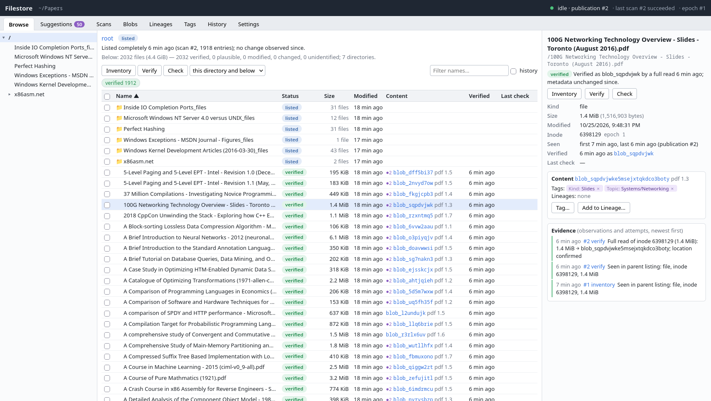
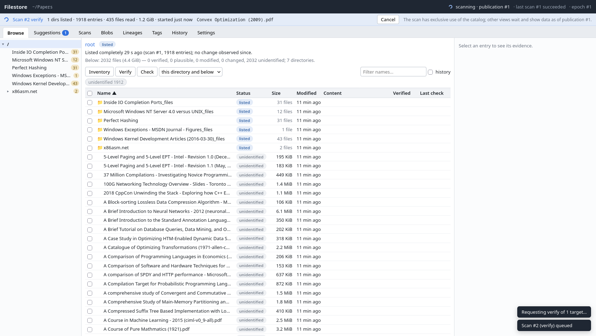
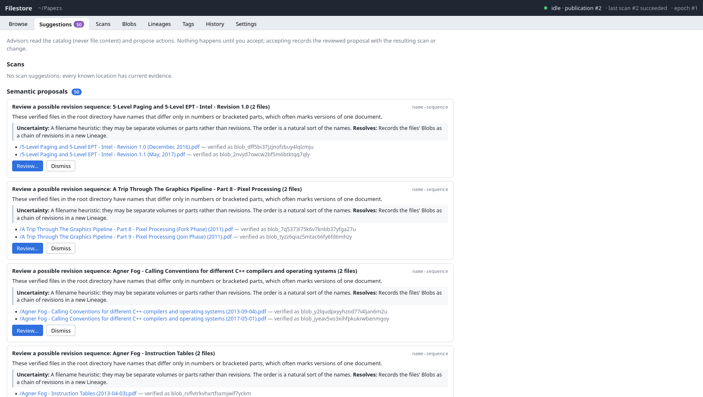
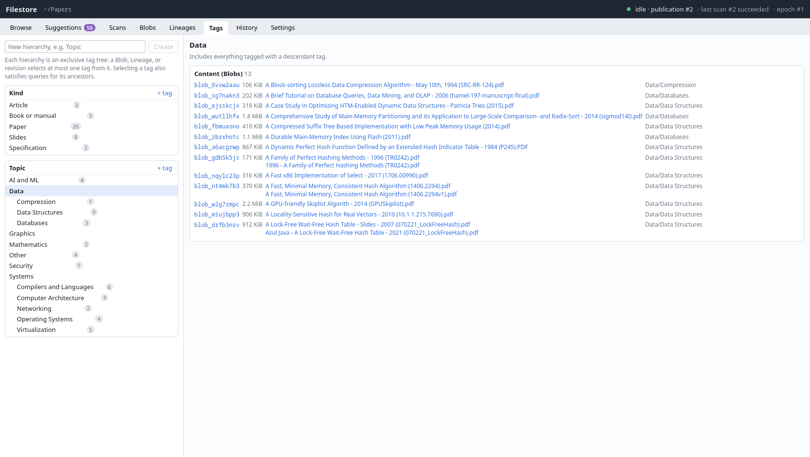

# Filestore prototype

> [!WARNING]
>
> <table>
>   <tr>
>     <td width="160" align="center" valign="middle">
>       
>     </td>
>     <td valign="middle">
>       <p><strong>AI-generated from a specification.</strong> This is a tool I (the human owner) made to manage directories that are more-or-less already organized but would benefit from tagging and a little more bookkeeping. A file gets a unique ID you can use in other utilities without the risk of leaking file metadata. (i.e. it is not a raw hash of the file) Compared to other filetagging solutions, it is a bit more strict and some features (thumbnails, similarity, multiple drives) are missing.</p>
>     </td>
>   </tr>
> </table>

Filestore catalogs the files in a directory tree that you keep editing with
other tools. Each scan records what it saw, content is recognized by reading
it in full, and you can hang tags and revision histories on that content. The
UI shows how strong the evidence behind each file is: *verified*,
*plausible*, *modified?*, *changed*, *unidentified*, or *gone*.

This is a prototype of the design in [doc/DESIGN.md](doc/DESIGN.md): a
synchronous Rust core, an Axum server, and a mouse-driven web UI. Linux only.

## What it does

* **Three kinds of scan.** *Inventory* lists directories and records names,
  inodes, sizes, and timestamps without reading content. *Verify* reads every
  byte of a file and hashes it. *Check* re-reads small files and samples large
  ones, then compares against the last verified content. Each can target a
  file, a directory (to a chosen depth), or the whole root.
* **Content has random IDs.** Identical files share one Blob (`blob_…`).
  Digests stay in the catalog and never appear in the API or UI.
* **Nothing is overwritten.** Observations, scan results, and decisions are
  kept as history; the current view is a projection you can rebuild.
* **Tags and Lineages.** Tags attach to content, so every copy shares them.
  A Lineage orders the revisions of a document. Every change is logged with
  before and after values.
* **Suggestions.** Advisors read the catalog and propose scans, possible
  moves, and Lineages. Nothing runs until you accept, and the catalog records
  where the action came from.
* **Your tree is read-only to it.** The scanner never modifies files, follows
  symlinks, or crosses mounts. If the root is replaced by a copy, scans fail
  with *root replaced* instead of reporting everything deleted.

Not there yet: combined tag search, manifests and bundles, thumbnails (only
format sniffing runs on content), and a report comparing a restored tree
against the catalog. [doc/PLANS.md](doc/PLANS.md) has the plans.

## Gallery

The screenshots show a clone of [tpn/pdfs](https://github.com/tpn/pdfs), a
public collection of technical papers and slides, used here as sample data.
Thanks to its maintainer. The tags were assigned for this demo and are not part
of that repository.

**Browse.** Each file shows its evidence status, the Blob it was read as, and
a marker when it is tagged. The right pane lists its tags and the observations
behind the status.



**Verify.** A scan owns the catalog while it runs; the banner shows progress
and offers Cancel.



**Suggestions.** Advisors propose scans, moves, and Lineages, with the
uncertainty and evidence for each. Nothing happens until you accept.



**Tags.** Exclusive hierarchies on content, with usage counts and the content
under each tag.



## Getting started

Requirements: Linux 5.6+ (for `openat2`), Rust 1.88+, Node 20+.

```sh
cd web && npm install && npm run build && cd ..
cargo build --release
target/release/filestore serve --catalog ~/filestore-catalog --root ~/Documents
# open http://127.0.0.1:7878/
```

* `--root` is only needed the first time; it creates the catalog. The catalog
  directory must be **outside** the root, and vice versa.
* Start with a directory of a few thousand files. Verify reads every byte, so
  your disk sets the pace; Inventory is cheap.
* **The catalog is as sensitive as the files**: it holds paths, sizes, content
  digests, and tags.
* Ctrl-C cancels a running scan and publishes the work it finished. If the
  process dies instead, the next start records that scan as *abandoned* and
  none of its evidence counts.
* The schema has no migrations yet. After a version that changes it, you
  need a fresh catalog.

The same binary runs scans without the UI. It takes the same exclusive
catalog lock, so it cannot run while the server holds that catalog.

```sh
filestore init    --catalog DIR --root DIR
filestore scan    --catalog DIR inventory|verify|check [PATH ...] [--depth N]
filestore suggest --catalog DIR      # print the advisors' suggestions
filestore rebuild --catalog DIR      # recompute the projection, compare with the incremental one
```

## A short tour

1. **Suggestions → Accept: inventory.** Every file starts *unidentified*.
2. **Browse → Verify.** Each file is read and hashed; identical files share a
   Blob. While a scan runs it owns the catalog, so other views show their last
   data until it finishes.
3. **Change things outside Filestore, then Inventory again.**
   * Edit, touch, or chmod a file: it becomes **modified?**. Metadata alone
     is not proof of content.
   * Rename or move a file: the old path is **gone** and the new one is
     *unidentified*. A *possible moves* suggestion cites the shared inode, but
     nothing transfers until you verify.
   * Delete a file: it leaves the current view. Its Blob stays under
     **Blobs → no current location**.
4. **Check.** Files up to 1 MiB are fully re-read. Larger files are sampled
   (16 blocks of 64 KiB) and come out **plausible** or **changed**. An edit
   outside the sampled blocks goes unnoticed; that blind spot is by design.
5. **Verify a changed file.** Filestore proposes recording the old and new
   content as revisions of one Lineage.
6. **Tag.** Select verified files, then **Tag…**. Unverified files cannot be
   tagged.

**Scans** shows every scan's targets, results, gaps, and diagnostics.
**History** lists every semantic change with before and after values.

## Documentation

* [doc/DESIGN.md](doc/DESIGN.md): the model, its vocabulary, and the
  procedures. [OPEN_QUESTIONS.md](doc/OPEN_QUESTIONS.md) and
  [IDEAS.md](doc/IDEAS.md) sit beside it.
* [doc/IMPLEMENTATION.md](doc/IMPLEMENTATION.md): where the prototype departs
  from the design, the edge cases it handles, defaults, and timings.
* [doc/PLANS.md](doc/PLANS.md): planned features and the recipe for adding an
  extractor.
* [doc/SCHEMA.dot](doc/SCHEMA.dot): the implemented schema, generated by
  `doc/schema_dot.py`.
* [AGENTS.md](AGENTS.md): commands, invariants, and conventions (written for
  coding agents, useful to anyone).

## Development

```
crates/filestore/          synchronous core: catalog, scanner, projection, advisors, semantics
crates/filestore-server/   `filestore` binary: CLI, Axum API, single worker thread
web/                       Vite + React + TypeScript UI, served from web/dist
```

`cargo test` runs the unit and integration tests, which build real directory
trees under `.local/test-tmp/`. For UI work, run `npm run dev` in `web/`; it
proxies `/api` to a server on the default port.

## License

MIT. See [LICENSE](LICENSE).
